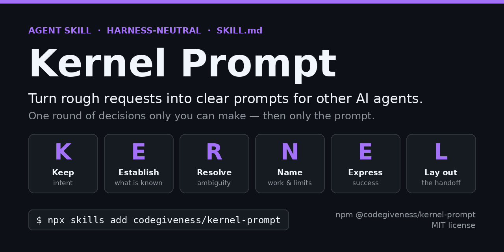

<p align="center"></p>

# Kernel Prompt

[](https://github.com/codegiveness/kernel-prompt/actions/workflows/ci.yml) [](https://www.npmjs.com/package/@codegiveness/kernel-prompt) [](https://www.npmjs.com/package/@codegiveness/kernel-prompt) [](LICENSE) [](https://agentskills.io/specification)

`kernel-prompt` is a small, harness-neutral prose skill that turns your message—a draft prompt or a task you want an AI agent to do—into an improved prompt for that agent. It first asks you each decision that is still open, as many questions as the request needs, then writes the prompt while preserving your intent and saves it to a file. It writes the instruction, never the task's result.

Select it when you invoke it by name or ask to compose or improve an LLM prompt or an instruction for another AI. Reviewing documents or collaboration guidance—even with wording suggestions—is not by itself a match. Asking to turn that guidance into a system prompt is.

## Use it

In an LLM chat, provide the contents of [SKILL.md](skills/kernel-prompt/SKILL.md) as guidance alongside your request. No installation is needed. With the skill available, ask:

```text
Use kernel-prompt to improve this request:
[your goal or draft, with relevant context and constraints]
```

Before it writes, the skill settles every decision that changes the prompt. Facts come from files and tools; only decisions that you alone can make become questions, each led by a recommended answer and using the harness's question tool when one exists. The request sets the number of questions and rounds: none when the context settles everything, more when the request is vague, and a further round only for decisions your answers opened. An assumption that would change the prompt becomes a question. Before saving, the skill also replaces each vague word in its draft ("better", "appropriate", "as needed") with a concrete criterion, asks you about it, or marks it open. Say "no questions" or "just write it" to stop the questions; open points are then marked open in the prompt and listed as assumptions in the reply.

The prompt is saved to `./.kernel-prompt/YYYY-MM-DD_HHMM_short-title.md` in the session's working directory (local time, no colon, so the name is valid on Windows), and the reply is that path alone. The file holds only the prompt, ready to send. A decision record beside it, ending in `.decisions.md`, keeps your original request, each question with your answer, and each unconfirmed point, so a later session can tell confirmed points from assumptions. To change the prompt later in the same session, ask for the change: the skill reads the file first, keeps your own edits, changes only the affected parts in place, and replies with the same path. An unrelated new request gets a new file. Say "don't save" or "in chat", or use a harness without file tools, to get the prompt in a fenced code block instead (a four-backtick fence when the prompt itself contains triple backticks).

English prompts are written in a plain subset of ASD-STE100 Simplified Technical English: one instruction per sentence, each condition before its command, "must" only for requirements you stated or confirmed and "can" for permissions and choices left to the agent (never "should", "may", or "might"), and one term for each thing and action. A "should" that only expresses a preference becomes a default. Prompts in other languages keep the natural style of your message, and the questions to you are not restyled.

Invoking the skill with text that reads as a task—"fix the failing login test"—yields a prompt for that task, not the fix. Files, skills, URLs, and repositories you mention are read as context for the prompt, not rewritten as the deliverable, unless you say that text is the prompt to improve. The skill writes no file except the prompt file and its decision record, and it does not touch your `.gitignore`; add `.kernel-prompt/` there yourself if you do not want to commit your prompts.

## The idea

A kernel makes the intended outcome, relevant context, boundaries, and completion conditions clear. Add detail where it helps the task; leave unassigned execution choices open. Facts are looked up, not asked; only decisions the user alone can make become questions. The prompt is written for its recipient—a capable agent without the conversation, unable to ask—and checked before replying so it holds the instruction, not the task's result.

**KERNEL** is a mnemonic, not a mandatory sequence or template:

- **K**eep intent.
- **E**stablish what is known.
- **R**esolve ambiguity.
- **N**ame the work and boundaries.
- **E**xpress success.
- **L**ay out the handoff.

The guiding reference is OpenAI's [Rethinking skills and prompts for GPT-6 Astra](https://developers.openai.com/blog/rethinking-skills-and-prompts-for-gpt-6-astra). Revisit accumulated instructions, avoid unnecessary recipes, and adapt guidance to the task and model. The article's model-specific advice is not a universal rule; clearer prompts do not guarantee correct answers.

Questions follow the same split between facts and decisions. The skill looks facts up and asks only the decisions that you alone can make, each with a recommended answer. The request sets how many questions and rounds it takes, and an assumption that would change the prompt becomes a question instead of a guess, so the recipient gets a prompt in which each point is settled or marked open.

The plain-English rules apply a small subset of [ASD-STE100](https://www.asd-ste100.org/) Simplified Technical English to agent instructions. Kernel Prompt keeps only the few rules that changed its prompts in testing and none of the STE dictionary, so its prompts make no STE compliance claim. The skill's own instructions follow the same rules, and its structure follows the [Agent Skills authoring guidance](https://agentskills.io/skill-creation/best-practices). ASD-STE100 is a registered trademark of ASD.

## Optional installation

For harnesses supporting [Agent Skills](https://agentskills.io/specification), install with the Skills CLI:

```bash
npx skills@latest add codegiveness/kernel-prompt
```

Choose the harness and installation scope when prompted. Add `--copy` if symlinks are unsupported. To install this working copy instead of the GitHub revision, run `npx skills@latest add .` from the repository root.

You can also copy `skills/kernel-prompt/` into your harness's skill location. Only `SKILL.md` is needed. The skill has no application runtime, build step, or project dependencies; the optional installer is external tooling.

## npm package

The skill is also published as [`@codegiveness/kernel-prompt`](https://www.npmjs.com/package/@codegiveness/kernel-prompt). The package contains only the skill files, with the skill at `skills/kernel-prompt/SKILL.md`; it has no CLI or runtime. Use it when you want a versioned, pinnable copy:

```bash
npm install @codegiveness/kernel-prompt
```

Then copy `node_modules/@codegiveness/kernel-prompt/skills/kernel-prompt/` into your harness's skill location. Releases are staged with `npm stage publish` and go live only after a maintainer approves them with two-factor authentication; [RELEASING.md](RELEASING.md) lists the full release workflow.

Versions 0.1.0 through 0.2.0 remain deprecated: they carry historical skill content, and 0.1.x also shipped an `install`/`update` CLI that no longer exists. Replace only your existing Kernel Prompt skill with the current `SKILL.md`, preserving local edits and unrelated instructions; deprecation does not remove installed files or update copied instructions.

[MIT license](LICENSE)
